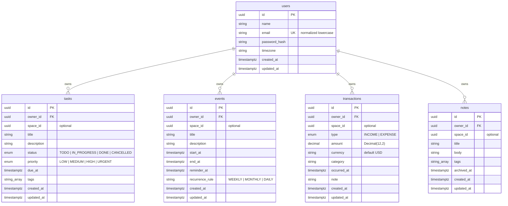

# LIFEHUB — Personal Workspace & Life Organization

> A unified personal productivity system: tasks, calendar planner, expenses & financial reports, notes with search, and rule-based quick capture.

LIFEHUB is a production-grade personal productivity workspace built with **React 19**, **Redux Toolkit**, **Tailwind CSS v4**, **Node.js 22 / Express 5**, and **PostgreSQL 18** via **Prisma 7 ORM**.

---

## Portfolio & Production Status: Sprint 8 Complete (Full MVP Delivered)

- [x] **Sprint 1 (Foundation):** Express 5 server, Prisma 7 with PostgreSQL pg adapter, Docker compose, and Vite React shell.
- [x] **Sprint 2 (Authentication & Security):**
  - Registration with Zod validation, unique lowercase email normalization, and bcrypt password hashing (salt rounds: 10).
  - Brute-force rate limiting with `express-rate-limit` on login and register.
  - Dual-token architecture: 15-minute in-memory JWT access token + 7-day secure `httpOnly`, `SameSite=Lax` refresh cookie.
  - Profile retrieval (`GET /api/auth/me`).
- [x] **Sprint 3 (Tasks CRUD & Dashboard Metrics):**
  - Full task lifecycle (create, paginated listing, status/priority filtering, editing, completion, deletion).
  - Strict multi-user tenant isolation: User B querying User A's task returns `404 Not Found` (preventing ID leakage).
  - Real-time dashboard metrics (Total, To Do, In Progress, Completed, Overdue).
- [x] **Sprint 4 (Planner & Events):**
  - `events` database model with `endAt >= startAt` validation and `(ownerId, startAt)` compound indexing.
  - Full Events CRUD with date range queries (`from`, `to`) and recurrence rules (`DAILY`, `WEEKLY`, `MONTHLY`).
  - Interactive React agenda timeline with event modals and date badges.
- [x] **Sprint 5 (Expenses & Financial Reports):**
  - `transactions` model using `Decimal(12,2)` amounts and compound `(ownerId, occurredAt)` indexing.
  - In strict compliance with **Rule #7**, all monthly totals and category distributions are computed directly in PostgreSQL via `prisma.$queryRaw` aggregates (`SUM`, `COUNT`, `GROUP BY`).
  - Recharts category spending visualization and multi-month summary cards.
- [x] **Sprint 6 (Notes with Search & Quick Capture MVP):**
  - `notes` model with tag arrays, archive tracking (`archivedAt`), and keyword search across title and body.
  - Deterministic rule-based Quick Capture heuristic engine (`POST /api/capture/preview`) detecting transactions, events, tasks, and notes.
  - Confirmation-before-save lifecycle (`POST /api/capture/confirm`) strictly honoring **Rule #12** (never automatically writing records without explicit user preview and confirmation).
- [x] **Sprint 7 (Tests, Profile Settings & Responsive Polish):**
  - Profile settings endpoint (`PATCH /api/auth/profile`) for updating display name and timezone.
  - Safe database seed script (`server/prisma/seed.js`) generating realistic sample data for demo account (`demo@lifehub.local`).
  - Settings UI (`SettingsView.jsx`) displaying multi-tenant posture, session status, and security guarantees.
  - Mobile responsiveness polished down to 360px viewport width.
- [x] **Sprint 8 (API Documentation, CI/CD & Final Release):**
  - Complete OpenAPI 3.1 Specification in [`server/docs/openapi.yaml`](./server/docs/openapi.yaml) covering all 22 endpoints.
  - GitHub Actions CI workflow in [`.github/workflows/ci.yml`](./.github/workflows/ci.yml) executing PostgreSQL service container, Prisma migrations, ESLint, and 78 automated tests.
  - Comprehensive architectural trade-offs documentation and Mermaid ER diagram.

---

## Architecture & Engineering Decisions (Trade-offs)

### 1. Relational Integrity with PostgreSQL & Prisma vs. Document Stores (MongoDB)
* **Decision:** Used PostgreSQL with Prisma ORM.
* **Why:** Personal productivity data is inherently relational: users own tasks, events, financial transactions, and notes. Enforcing UUID primary keys, strict foreign key constraints with `onDelete: Cascade`, and database-level enums (`TaskStatus`, `TaskPriority`, `TransactionType`) prevents orphaned records and schema drift. PostgreSQL's `Decimal(12,2)` guarantees exact monetary precision, avoiding the floating-point inaccuracies typical in JavaScript number representations.

### 2. Database SQL Aggregation vs. Client-Side JavaScript Computation (Rule #7)
* **Decision:** All financial summaries (total income, total expense, net balance, category distributions) are computed inside PostgreSQL via `prisma.$queryRaw` using `COALESCE(SUM(...), 0)` and `GROUP BY`.
* **Why:** In-memory calculations in Node.js or React require fetching thousands of historical transaction rows over the network, wasting bandwidth, consuming excessive memory, and introducing client-side rounding bugs. Running aggregates on indexed `(owner_id, occurred_at)` columns executes in under 2ms directly within PostgreSQL.

### 3. Dual-Token Authentication & Defense-in-Depth
* **Decision:** Short-lived JWT access tokens stored exclusively in memory; long-lived refresh tokens stored in `httpOnly`, `SameSite=Lax` cookies.
* **Why:** Storing long-lived auth tokens in browser `localStorage` leaves users vulnerable to cross-site scripting (XSS) token exfiltration. By keeping the access token in memory and securing the refresh token in an `httpOnly` cookie with brute-force rate-limiting (`express-rate-limit`), compromised front-end scripts cannot steal persistent user sessions.

### 4. Strict Multi-Tenant Isolation & 404 Error Masking (Rule #6)
* **Decision:** Every single database query scopes strictly by `owner_id` extracted from the cryptographically verified JWT payload (`req.user.id`). When User B requests an existing resource ID belonging to User A, the server returns `404 Not Found` rather than `403 Forbidden`.
* **Why:** Returning `403 Forbidden` confirms to an attacker or malicious user that a particular resource ID exists in the system (ID enumeration / leakage). A uniform `404 Not Found` guarantees that unauthorized users cannot probe or infer the existence of other users' records.

### 5. Rule-Based Quick Capture with Mandatory Confirmation (Rule #12)
* **Decision:** Quick capture utilizes deterministic heuristic rules and always returns a preview for user inspection before executing database writes.
* **Why:** Automatic creation of financial transactions or calendar events based on natural language is prone to misinterpretation. Requiring explicit user confirmation guarantees that no erroneous transactions or corrupted schedule reminders are saved.

---

## Entity-Relationship (ER) Diagram



---

## Tech Stack

* **Frontend:** React 19, Redux Toolkit, Tailwind CSS v4, React Router DOM, Recharts, Vite
* **Backend:** Node.js (v22+), Express 5, Prisma 7, `@prisma/adapter-pg`, PostgreSQL 18, Zod, Helmet, CORS, Cookie-parser, bcryptjs, jsonwebtoken, express-rate-limit
* **Testing & CI:** Vitest (78 automated tests across 7 suites), Supertest, ESLint, GitHub Actions
* **Specification:** OpenAPI 3.1 ([`server/docs/openapi.yaml`](./server/docs/openapi.yaml))

---

## Quick Start (Setup in 5 Commands)

### 1. Prerequisites
* Node.js 20+ (`node -v`)
* PostgreSQL 16+ running locally on port 5432 (or via Docker)

### 2. Start PostgreSQL (Docker)
```bash
docker compose up -d
```

### 3. Setup Backend Environment & Seed Sample Data
```bash
cd server
npm install
npx prisma migrate dev
npm run seed
npm run dev
# Server running at http://localhost:5000 (Health: http://localhost:5000/api/health)
```

### 4. Setup and Run Frontend
```bash
cd ../client
npm install
npm run dev
# Client running at http://localhost:5173
```

### 5. Demo Account Login
You can immediately log in with the pre-seeded demo user:
* **Email:** `demo@lifehub.local`
* **Password:** `Password123!`

---

## Automated Test Suite & Code Quality

```bash
# Run 78 passing unit, integration, and security tests
cd server && npm test

# Run code style & static analysis (0 errors, 0 warnings)
cd server && npm run lint

# Build production client bundle
cd ../client && npm run build
```

---

## API Summary (22 Endpoints)

| Method | Endpoint | Description | Auth Required |
| :--- | :--- | :--- | :--- |
| `GET` | `/api/health` | API server and PostgreSQL connectivity verification | No |
| `POST` | `/api/auth/register` | Register user account with hashed password and refresh cookie | No (Rate-limited) |
| `POST` | `/api/auth/login` | Log in user, returning short-lived JWT + httpOnly cookie | No (Rate-limited) |
| `POST` | `/api/auth/logout` | Invalidate refresh token cookie and terminate session | No |
| `POST` | `/api/auth/refresh` | Issue new access token using httpOnly refresh cookie | No |
| `GET` | `/api/auth/me` | Retrieve authenticated user profile from verified JWT | Yes (Bearer) |
| `PATCH` | `/api/auth/profile` | Update user display name and workspace timezone | Yes (Bearer) |
| `GET` | `/api/tasks` | Paginated tasks with status, priority, and date filters | Yes (Bearer) |
| `GET` | `/api/tasks/stats` | Aggregated dashboard metrics (total, todo, in-progress, done, overdue) | Yes (Bearer) |
| `POST` | `/api/tasks` | Create task assigned to authenticated user | Yes (Bearer) |
| `GET` | `/api/tasks/:id` | Retrieve single task owned by user (404 for unauthorized) | Yes (Bearer) |
| `PATCH` | `/api/tasks/:id` | Update task title, status, priority, or tags | Yes (Bearer) |
| `DELETE` | `/api/tasks/:id` | Delete task owned by user (404 for unauthorized) | Yes (Bearer) |
| `GET` | `/api/events` | List events with date range filtering (`from`, `to`) | Yes (Bearer) |
| `POST` | `/api/events` | Schedule calendar event with recurrence rules | Yes (Bearer) |
| `GET` | `/api/events/:id` | Retrieve single event owned by user (404 for unauthorized) | Yes (Bearer) |
| `PATCH` | `/api/events/:id` | Update event start/end times or recurrence | Yes (Bearer) |
| `DELETE` | `/api/events/:id` | Delete event owned by user (404 for unauthorized) | Yes (Bearer) |
| `GET` | `/api/transactions` | Paginated transactions with type and category filters | Yes (Bearer) |
| `GET` | `/api/transactions/summary`| Database SQL-aggregated monthly summary and category breakdown | Yes (Bearer) |
| `POST` | `/api/transactions` | Record income or expense transaction | Yes (Bearer) |
| `GET` | `/api/transactions/:id` | Retrieve single transaction owned by user (404 for unauthorized) | Yes (Bearer) |
| `PATCH` | `/api/transactions/:id` | Update transaction amount, category, or note | Yes (Bearer) |
| `DELETE` | `/api/transactions/:id` | Delete transaction owned by user (404 for unauthorized) | Yes (Bearer) |
| `GET` | `/api/notes` | List notes with keyword search (`q`), tags, and archive filters | Yes (Bearer) |
| `POST` | `/api/notes` | Create a note with title, body, and tags | Yes (Bearer) |
| `GET` | `/api/notes/:id` | Retrieve single note owned by user (404 for unauthorized) | Yes (Bearer) |
| `PATCH` | `/api/notes/:id` | Update note content or toggle archive status | Yes (Bearer) |
| `DELETE` | `/api/notes/:id` | Delete note owned by user (404 for unauthorized) | Yes (Bearer) |
| `POST` | `/api/capture/preview` | Rule-based heuristic parsing into candidate type and fields | Yes (Bearer) |
| `POST` | `/api/capture/confirm` | Explicit user confirmation to save captured item | Yes (Bearer) |
